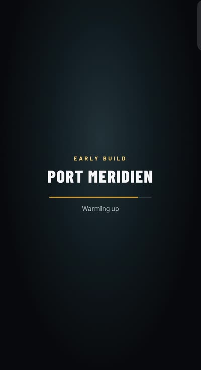

# Port Meridien


**[Play Port Meridien in your browser](https://joyeechuah.github.io/Port-Meridien/)**

Race the coastal roads, explore Old Quay on foot, or take a boat across the harbour. Port Meridien is a 3D open-world browser game built with Three.js for desktop and mobile. It builds on [White Isle Drive](https://github.com/joyeechuah/white-isle-drive) with an original city, characters and activities.

## Play

1. Open the game and choose **Play as guest**. Progress saves in this browser. Watch the harbour flyover or select **Skip intro** to go straight to the wardrobe. Reduced motion also skips the flyover.
2. Choose **Harbour palms**, **Boardwalk stripe** or **Night shift**. Use **Turn around** to inspect the fit, then **Wear outfit & drive** to start in Old Quay. Left and right arrows or the controller D-pad change outfits. On a controller, Y turns the preview and A confirms.
3. Try a coastal drive. Accelerate with W, steer with A and D, and brake with S. To reverse after braking, stop, release the brake and press it again. On a phone, use the steering and pedal pads.
4. Stop near the harbour and select **Get out** to walk. Follow the pier to the motorboat and use the boarding prompt. To return to your car, walk up to it and select **Get in**.
5. Open **Map** to plan a route. For a delivery or a race series, open **Pause → Contracts** or **Pause → Championships**. For car customisation or a free repair, choose **Pause → Go home**.



*Old Quay from the opening flyover, captured on Android.*

### Graphics and saved settings

In the pause menu, select **GRAPHICS** to cycle through the three modes.

| Mode | What it does |
| --- | --- |
| AUTO | Tries a lower resolution when frames stay slow. If the typical frame time barely changes, it restores the previous resolution. |
| SHARP | Keeps the game at its highest supported resolution for this display. |
| SMOOTH | Caps rendering at one game pixel per CSS pixel to reduce the graphics workload on high-density screens. |

The browser remembers your graphics mode, FLASHES setting, VIOLENCE level and pistol selection when you reload.

## Controls

| | Keyboard | Touch | Controller |
| --- | --- | --- | --- |
| Gas / brake, reverse | `W` / `S` (or arrows) | GAS / BRAKE pads | Right / left trigger |
| Steer | `A` / `D` (or arrows) | Steering pads, or tilt | Left stick |
| Run on foot | Hold `Shift` or `Space` | Hold RUN | Hold A |
| Handbrake | `Space` | HANDBRAKE pad | `A` |
| Get out | `F` | GET OUT | `B` |
| Use the nearby interaction prompt | `E` or `Enter` (also `F` on foot or aboard) | Tap the prompt | `X` |
| Map and GPS | `M` | MAP | View / Back |
| Camera | `C` | CAM | `Y` |
| Look behind | Hold `B` | REAR | Hold left shoulder |
| Photo Mode | `V` | PHOTO | |
| Return the car to the road outside an event | `R` | — | — |
| Fire (on foot or in free driving) | `G` | FIRE | Right shoulder |
| Pause | `Esc` or `P` | PAUSE | Menu / Start |

On smaller screens, **Map Key** opens the legend and Explorer Passport. Open the map and select **ME** to centre it on your current position. The arrow follows your position and heading while driving, walking or sailing. GPS routes follow the road network. On touchscreens, you can hold RUN or HANDBRAKE while tapping FIRE with another finger.

## On foot

Stop the car and get out. Gas walks forward, brake steps back, steering turns, and holding `Shift`, `Space`, the RUN pad or controller `A` makes you run forward. Walk back to the car and get in. Traffic stops for you if you stand in the road. The car you got out of falls silent while you're away from it.

On foot you can also take any traffic car that has stopped: stand in its lane so it stops, walk to it and get in. The car you came from stays where you left it, and you can walk back and drive it again. Up to three taken cars stay where you left them. A taken car isn't yours: it is not saved, and it's gone when you go home.

## The harbour and the boat

A pier stands on the east coast, straight out from the town past the end of its main avenue: look for the mast with a red marker. A lane runs down to the shore from where the avenue meets the coast road: park at its end and walk on (cars don't fit between the bollards).

Walk along the pier to the motorboat and board it. The driving controls sail it: gas for power, brake for reverse, steering to turn (a boat only turns while it's moving). You hear its motor and the water along the hull. It stays in deep water and turns back at the open sea. To get off, come back beside the pier, slow to a stop, and step off. The boat stays where you leave it.

## Old Quay

The port town on the east side has six blocks between its streets:

| Block | What's there |
| --- | --- |
| North-west | Terraces with shops, two to four floors |
| North-middle | A market yard round a clock tower, with stalls. Ways in from both side streets and from the avenue |
| North-east | Workshops in four old warehouses, with lanes between them |
| South-west | Houses round a garden |
| South-middle | A civic square: the Harbour Hall, a fountain, benches and palms |
| South-east | The Auto Gallery, where you buy and test-drive cars |

You can walk or drive into the market, the square, the garden and the lanes.

### People

Up to ten people (six on a phone) walk the pavements round the six blocks. They cross the streets on the zebra crossings, and wait while a car is on the stripes, close by, or heading for the crossing; after 10 seconds of waiting they give up and walk on. Traffic stops for someone crossing. A car can't hurt them yet: drive at one and they step in towards the houses, or hurry off the crossing. They're only there while you're near the town.

## The police

Two patrol cars drive with the traffic: white, with a blue band and a light bar, and blue dots on the minimap. A crime one of them sees makes you **wanted**, shown as stars under the district name:

| Crime (seen by a patrol within about 90 m) | Stars |
| --- | --- |
| Crashing into a car | 1 |
| Running into someone on foot | 1 |
| Taking a car | 1 |
| Speeding past a patrol (over 110 km/h, within 45 m) | 1 |
| Hitting a police car | 2 |

Each further crime adds a star, up to five. Nothing counts during a race or a test drive.

While you're wanted, police cars chase you along the roads, more of them the more stars you have, with lights and sirens. Stop and let one pull up beside you, and you're **caught**: a fine of 500 CR a star, and the stars are gone. Off the road, an officer gets out and comes for you on foot. You can outrun them, but not for ever.

Get out of their reach and stay out of it long enough (the stars blink meanwhile) and they **lose you**. The boat is out of their reach.

While you're wanted, your house, the Auto Gallery, races, contracts, going home and map travel are closed: lose the police first. A reload clears a wanted level.

## The pistol and health

Take the pistol from the garage with **PISTOL**, top right under MUSIC (it stays chosen until you change it). You can use it on foot and while driving outside races and test drives. You leave the house with 48 rounds.

It locks onto the nearest target in front of you, shown by a red ring: a car, a police car, someone walking, or an officer. Walls and cars are cover. Fire with `G`, the **FIRE** pad, or the controller's right shoulder. A car stops after about nine hits; someone shot is knocked down for 6 s and gets up again.

The police see shooting as they see any crime: firing is one star, hitting a car or a person one, shooting at the police two. At three stars, an officer on foot fires back.

Your **health** is 100, shown as a bar under the place and clock. After 6 s with nothing hurting you it comes back to 50; it's full again at the house. At 0 you're **knocked out** and wake at home, 10% of your credits poorer (at most 5,000). Caught by the police while carrying the pistol, you're **arrested**: the fine, the pistol back in the garage, and you start again outside the Harbour Hall.

Two settings in the pause menu, both saved:

| Setting | Choices |
| --- | --- |
| VIOLENCE | **LOW**: nobody falls. **STANDARD** (the default): people fall, no blood. **STRONG**: hits also leave a red mark that fades. It changes only what you see |
| FLASHES | **ON**, or **OFF**: no muzzle flash and no red flash when you're hit |

These rules are working decisions, recorded in [docs/STEP4_DECISIONS.md](docs/STEP4_DECISIONS.md), and may change before release.

## What works today

- **Driving:** 24 cars with made-up names, paint and customisation; collision damage and roadside repairs; keyboard, touch pads, tilt and game controllers.
- **On foot:** walking and running, getting in and out, taking stopped traffic cars, and going back to cars you left.
- **The boat:** a motorboat from the pier, with its own sound.
- **The world:** an island with roads, traffic, day and night, a map with GPS, Photo Mode, and the Old Quay district with people walking its streets.
- **The police:** patrols, a wanted level of one to five stars, chases by car and on foot, fines, and losing them.
- **The pistol:** lock-on aiming, health, being knocked out, arrest, and settings for violence and flashes.
- **Things to do:** races, time trials, championships, delivery contracts, speed radars and an explorer passport of 18 landmarks.
- **Saves** in the browser. Optional cloud saves are built in but switched off until this game has its own Firebase project (see [CLOUD_SETUP.md](CLOUD_SETUP.md)).

## What's next

| Step | What you'll be able to do | State |
| --- | --- | --- |
| 4 | More weapons, shooting from the boat, police cars that shoot, health pickups | Not decided yet |
| Later | The full city as its own world, with the island kept as a second place to drive | Planned |

The opening sequence and audio have been tested on an Android phone. The AUTO resolution change and Old Quay junction traffic still need a driving check on a physical phone.

## Development

To play locally, clone the repository, install Node.js 18 or later, then run these commands from the repository root.

```sh
npm ci
npm start
```

Open [the local game](http://127.0.0.1:4173/index.html). The page loads Three.js from a CDN, so the first load needs an internet connection.

```
npm run lint                                  # must be 0 errors, 0 warnings
npx playwright install chromium               # once
npx playwright test --project=chromium        # logic tests (about 25 min)
npx playwright test --project=webgl           # drawn tests, slow with a software GPU
```

GitHub Actions runs lint and both test projects on every pull request. The drawn tests can also be run on their own: Actions → **Drawn browser tests (WebGL)** → Run workflow.

Run one Playwright instance at a time: the test server uses port 4173 and reads `index.html` from disk on each page load, so don't edit it during a run.

- The game logic and interface live in `index.html`. Recorded music lives in `audio/`.
- Every fix or feature comes with a test that fails without it.
- Tests reach the game's internals through `window.__T`; add a name to the list in `tests/support/instrument.js` when a test needs one.
- In tests the police ignore crimes unless a test opens the game with `game.open({ police: true })`, so a crash in an unrelated test never starts a chase.
- `tests/world-baseline.spec.js` guards the roads, races, landmarks and contracts. A change to the world that moves any of them must update `tests/fixtures/world-baseline.json` on purpose (see `tests/fixtures/WORLD_BASELINE_README.md`).

### Documents

| File | What it covers |
| --- | --- |
| [ROADMAP.md](ROADMAP.md) | Steps, decisions, and the list of things to check before selling the game |
| [docs/ARCHITECTURE.md](docs/ARCHITECTURE.md) | How the code is laid out: game states, movement modes, the frame loop, tests |
| [docs/OLD_QUAY_PLAN.md](docs/OLD_QUAY_PLAN.md) | The Old Quay district plan and what it had to keep working |
| [docs/PIER_ROAD_CONNECTION_PLAN.md](docs/PIER_ROAD_CONNECTION_PLAN.md) | How the harbour lane joins the roads |
| [docs/PEDESTRIAN_DESIGN.md](docs/PEDESTRIAN_DESIGN.md) | The full design for people in the city |
| [docs/CITY_DESIGN.md](docs/CITY_DESIGN.md) | The design for the separate city world |
| [docs/DISTRIBUTION_REVIEW.md](docs/DISTRIBUTION_REVIEW.md) | Stores, age ratings and selling |
| [docs/CAR_TRADEMARK_SEARCH_WORKSHEET.md](docs/CAR_TRADEMARK_SEARCH_WORKSHEET.md) | Trademark checks for the 24 car names (none done yet) |
| [docs/ASSET_INVENTORY.md](docs/ASSET_INVENTORY.md) | Every asset and where it came from |

## Privacy

The default build saves progress in this browser’s local storage. It has no ads. On the game's own site it counts visits with Cloudflare Web Analytics: page views, countries, devices and load times, with no cookies or storage and nothing about you or your progress. It doesn't count a browser that asks not to be tracked (Global Privacy Control or Do Not Track), or any copy of the game outside joyeechuah.github.io. It loads three.js from cdnjs and fonts from Google Fonts. Deployments configured for optional Google sign-in can also back up progress to Firestore. If the game asks which save to keep, **Decide Later** postpones the choice. Reopen Cloud Save to compare the two copies. Ghost laps stay on the device. See [cloud save setup](CLOUD_SETUP.md).

## Content

Port Meridien is a mature game: you can shoot cars, people and the police. VIOLENCE in the pause menu controls how it's shown, from LOW to STRONG, with STANDARD as the default. It shows no blood by default.
