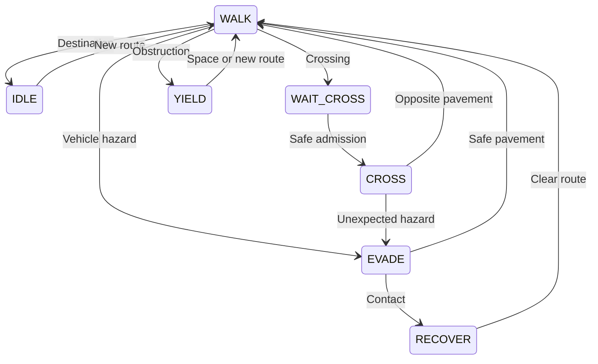

# Pedestrians: Step 2 design

13 November 2026 · Design only, awaiting approval and merged movement/world interfaces

## First deliverable

Make the waterfront look inhabited: adult NPCs walk along pavements, wait at crossings, avoid obstacles and react to an approaching vehicle. Start with non-combat ambient pedestrians. Weapons, injuries, arrest, wanted levels, crowds, conversation and schedules remain later work. No pedestrian code should be added to Claude's WIP branch.

The merged player walker may supply mesh construction or animation patterns. Do not use the singleton player FOOT object as an NPC, and do not call its input-driven update routine for every pedestrian. Share small geometry/collision utilities only after their ownership is agreed; keep player camera, controls and vehicle possession separate.

## Required inputs from the merged game

| Input | Needed for | Constraint |
| --- | --- | --- |
| Active player transform and movement mode | Activation distance, avoidance, reactions | Resolve walker, driven vehicle or boat through one agreed accessor |
| Walkable surfaces and boundary queries | Safe placement and movement | Pavements, ramps and docks; no water or building interiors |
| Vehicle snapshots with stable entity IDs | Traffic and stolen-car avoidance | Include moving, parked, borrowed and abandoned cars, not just TRAFFIC |
| Previous and current vehicle transforms | Swept collision and predictive crossing | Never rely only on end-of-frame point distances |
| Gameplay clock/state and tab ownership | Pause and resume | NPC simulation freezes with gameplay, not wall-clock time |
| World revision and scene lifecycle | Rebuild and cleanup | Invalidate routes, reservations and NPCs on world replacement |

These are interface requirements, not approved function names. Resolve them after merging on-foot, car-taking and the selected map implementation. If the island is retained, only seed pedestrians in areas with explicit walkable data; do not scatter them over terrain using nearestRoad.

## Navigation data

Use a small graph for the first district: pavement corners, entrances, resting points and crossing endpoints. Edges carry width, surface type, direction constraints, accessibility and an enabled flag. Crossing edges additionally name conflict lanes and holding areas. Stable graph IDs must not depend on mesh-array order.

Each NPC has a seeded destination choice and a bounded route search. Avoid a full pathfinding run every frame. Re-route only when the destination changes, an edge closes, or an obstacle persists beyond a short configurable wait. If no route exists, wait safely or retire out of view; never snap across a road or through a wall.

Suggested starting values for profiling, not guaranteed budgets:

| Setting | SMOOTH | Higher settings |
| --- | --- | --- |
| Maximum active pedestrians | 12 | 24 |
| Activation radius around player | 100 m | 150 m |
| Retirement radius | 150 m | 220 m |
| Route/decision updates | 5 Hz, staggered | 5–10 Hz, staggered |
| Animation | Interpolated per rendered frame | Interpolated per rendered frame |

Maintain a hard cap even if no retirement location is available. Keep an NPC active while it owns a crossing reservation, participates in contact or remains visible. Off-camera does not automatically mean safe to remove: consider shadows and imminent entry into the view.

## Behaviour

| State | Behaviour | Exit condition |
| --- | --- | --- |
| WALK | Follow pavement route; local separation | Destination, obstacle, hazard or crossing reached |
| IDLE | Stand at a selected resting point, clear of doors | Timer expires and next route is available |
| WAIT_CROSS | Wait inside the pavement holding area | Crossing admitted after traffic check |
| CROSS | Follow the admitted crossing edge | Reach the opposite pavement; release reservation |
| YIELD | Stop for another pedestrian or obstruction | Space opens or re-route timeout expires |
| EVADE | Move towards a verified safe pavement point | Immediate vehicle hazard has passed |
| RECOVER | Remain stationary after a non-combat contact | Safe route available and short recovery timer expires |

Every simulation tick first checks world teardown and gameplay suspension, then hazards; animation never decides whether an interaction occurred. Timers use simulation time. No setTimeout-driven state changes that can continue while paused or after an NPC has been reused.

## Crossings and traffic cooperation

Treat prediction as a decision aid, not a guarantee. Estimate the time for the NPC to clear every conflict lane from measured walking speed, crossing length and a margin. Check vehicles approaching in either direction and account for stopped vehicles that might accelerate. If the crossing is blocked by a parked/abandoned car, do not enter it.

For the first version, a crossing controller admits a bounded group and asks ambient traffic to yield before admitting it. Traffic braking should be bounded by its existing deceleration model; only admit pedestrians once a safe gap or stopped traffic is actually observed. Release the reservation when every admitted NPC exits or is safely recovered. Traffic must also yield to a player already on a marked crossing. An abandoned reservation must not stop the city forever.

Player-controlled vehicles cannot be assumed to obey the controller. Use collision prediction and a verified evasive destination. At high speed, detect swept vehicle-hull contact against the pedestrian capsule; otherwise a car can pass through an NPC between simulation samples. Test reversing, steering through a crossing, low frame rates and a newly stolen vehicle switching from traffic AI to player control.

## Contact without implementing combat early

Proposed Step 2 treatment: the pedestrian tries to evade; a confirmed collision causes one brief non-graphic stumble/recovery reaction. Do not award credits, streak points or repeat impact rewards. No blood, damage-to-NPC health, death or police response is introduced here. This is a staging choice for approval, not a reversal of the planned mature combat direction.

Use a per-contact event ID/cooldown so overlapping frames do not repeatedly trigger reactions or audio. A lightweight NPC must not act as an immovable wall that suddenly launches or stops a vehicle. Keep pedestrian collision handling separate from the building/vehicle damage solver until its response is designed and tested. A non-damaging version still needs to stop NPCs clipping through cars; it cannot simply ignore overlap.

Later combat can consume a neutral contact event, but do not add speculative health/police systems now. A future violence setting controls presentation; rules that determine who can be harmed belong to an explicit release profile, not a cosmetic blood toggle. See DISTRIBUTION_REVIEW.md.

## Spawn, lifecycle and performance

Spawn only on validated pavement nodes with free body clearance, away from doors, car entry points, the boat berth and active event starts. Never spawn in the camera frustum or inside another actor. During camera transitions and Photo Mode, suspend replenishment rather than spawning behind the previous camera.

Pool NPC objects and share meshes/materials where possible. On reuse, reset routes, animation, timers, contacts, visibility, reservations and generation IDs. Reject delayed work addressed to an old generation. Release only resources owned by that NPC; shared geometry/materials are disposed at world teardown.

Use a spatial grid for nearby actor queries instead of comparing every pedestrian with every vehicle. Fixed simulation steps or bounded swept substeps should give the same behaviour across frame rates. Catch-up after a background tab must not simulate minutes of missed collisions.

NPC positions are session-only in this phase. Persist the density preference, not every NPC's route or random timer. Re-entering a district generates a valid population without accumulating objects or payments.

## Mode and screen behaviour

- DRIVE encompasses walking/driving as defined by Claude's merged implementation; pedestrians update through one world path, never once in each mode handler.
- Freeze NPC movement, reservations and reaction timers during PAUSE, MAP, PHOTO and inactive-tab suspension. Photo camera movement may change visibility but must not create new pedestrians or advance animation.
- Garage/dealership transitions stop the old world simulation and release any relevant reservations without exposing stale actors on return.
- Boat mode activates shoreline pedestrians from the active player's location, not from the car left behind. Dock actors must keep the disembark area clear.
- Fast travel clears/reseeds the local population once; no per-frame reseeding or invisible colliders left at the previous location.
- Race traffic rules and pedestrian placement require a declared policy: keep the first pedestrian patch outside active race corridors unless crossings and player impact behaviour have been explicitly tested there.

## Acceptance matrix for implementation

| Test | Required outcome |
| --- | --- |
| Seeded graph route | All visited positions stay on the intended connected walkable surfaces |
| Closed passage | Wait/re-route without crossing a wall or water; bounded path searches |
| Vehicles in both lanes | No crossing admission until both conflict lanes are safe |
| Stolen vehicle transfer | One obstacle entity remains tracked; no duplicate traffic collider |
| Parked car across crossing | Crossing closes; waiting NPCs do not enter its hull |
| Fast/reversing vehicle | Swept contact detected once; no tunnelling or physics explosion |
| WALK/CAR/BOAT switches | Exactly one NPC update per tick and correct activation centre |
| Pause/map/photo/tab inactive | Positions and simulation timers unchanged; no catch-up burst |
| Fast travel/garage/world rebuild | Old reservations and collision entries gone; no stale callbacks |
| Repeated contact | No credits, streak farming or repeated audio every frame |
| 10-minute drive with 20 district/mode transitions | Population and scene resources reach a stable plateau |
| 30/60/120 Hz and uneven frames | Comparable paths and crossing behaviour within agreed tolerance |
| Phone landscape and night | Characters readable, dock/vehicle prompts unobstructed |

Profile on a named physical Android device before increasing population. Compare p95 frame time, worst crossing frame, route-search time and memory plateau against the same scene with pedestrians disabled. The counts above are initial experiments, not claims of a measured frame rate.

## Suggested PR sequence after prerequisites merge

1. Pavement graph, bounded routing and a seeded test scene; no active public crowd yet.
2. Spawn/pool/animation and WALK/IDLE/YIELD; validate lifecycle and performance.
3. Crossing controller and vehicle snapshots; integration tests for traffic and taken cars.
4. Contact/evade response and mobile visual validation.

Each PR needs a failing-before regression for its behaviour and explicit function ownership. No changes to on-foot tests or instrumentation are included in this design delivery.
